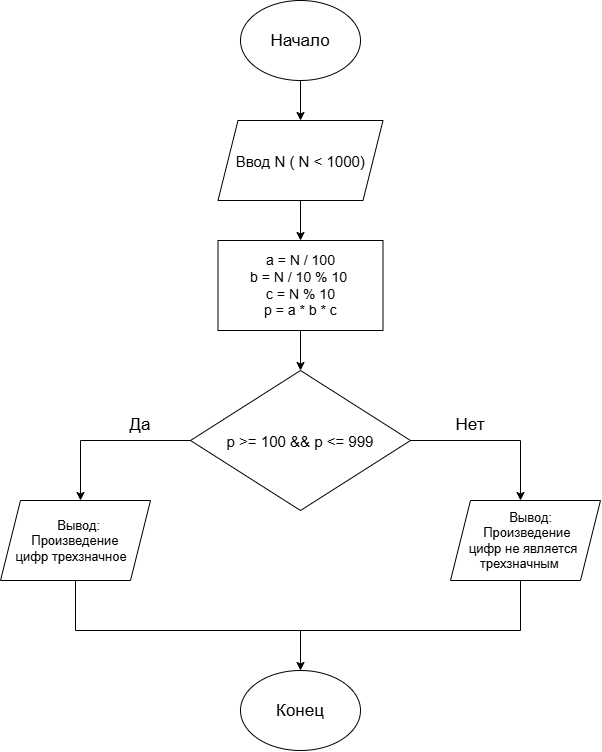

# Домашнее задание к работе 6

## Условие задачи
Дано число N (N<1000). Написать программу, которая проверяет
является ли произведение его цифр трехзначным числом.
# Блок схема:

## 2. Реализация программы
    #include <stdio.h>
    #include <locale.h> 
    int main() 
    {
    setlocale(LC_ALL, "Russian");
    int N,a,b,c,p;
    printf("Введите число N (<1000): ");
    scanf_s("%d", &N);
    a = N / 100;      
    b = (N / 10) % 10; 
    c = N % 10;        
    p = a * b * c;
    if (p >= 100 && p <= 999) {
        printf("Произведение цифр (%d) является трехзначным числом.\n", p);
    }
    else {
        printf("Произведение цифр (%d) не является трехзначным числом.\n", p);
    }
    return 0;
    }

# Информация о разработчике
Порошкова Кристина
бОТИ-262
